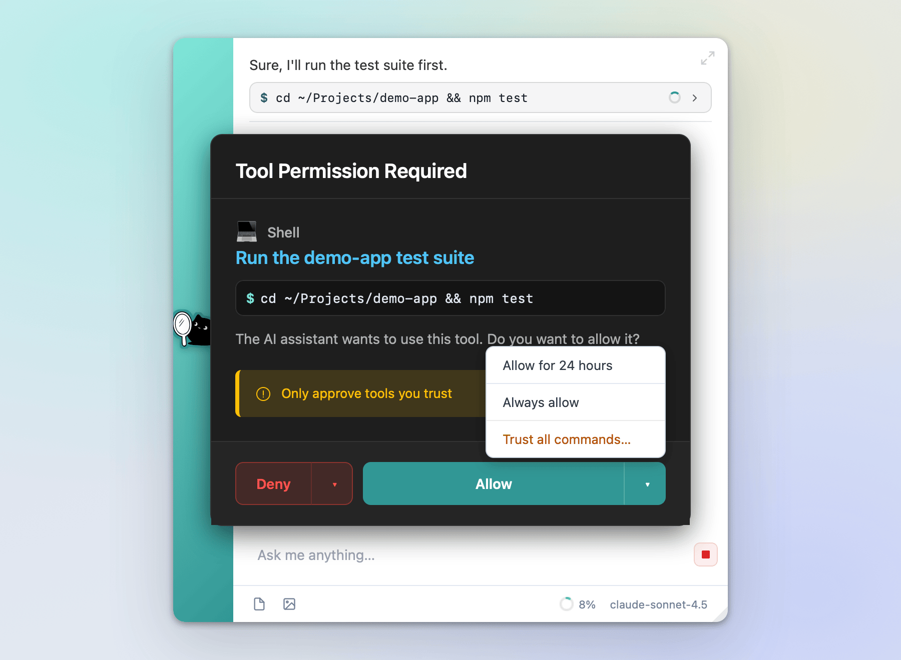

<p align="center">
  
</p>

<h1 align="center">Kage</h1>

<p align="center">
  <strong>Your AI, one keystroke away.</strong><br>
  A fast, extensible launcher for Windows and macOS that works with the AI agent you already use.
</p>

<p align="center">
  <a href="#install"></a>
  <a href="https://github.com/nachmore/Kage/releases/tag/dev-latest"></a>
  <a href="https://agentclientprotocol.com"></a>
  <a href="LICENSE"></a>
</p>

<p align="center">
  <a href="https://github.com/nachmore/Kage/releases/tag/dev-latest"><strong>Download</strong></a> ·
  <a href="#install">Install guide</a> ·
  <a href="#quick-start">Quick start</a> ·
  <a href="https://nachmore.github.io/Kage-Extensions/">Extension Store</a> ·
  <a href="#documentation">Docs</a>
</p>

<p align="center">
  
</p>

Press <kbd>Alt</kbd>+<kbd>Space</kbd> (<kbd>Option</kbd>+<kbd>Space</kbd> on a Mac) over any app and Kage opens a small bar where you are. Type a few letters to launch an app, convert units or open a folder. Or ask your AI agent a question and watch the answer stream in, along with every tool the agent uses to get there.

## Why Kage

- **Fast first.** Apps, maths, timers, folders and files answer as you type, on your machine. None of it goes to the AI.
- **Your agent, not ours.** Kage doesn't include a model or need an account. It talks to the agent you choose: Kiro CLI, Claude Code, OpenAI Codex, a local model through Ollama, or any other agent that speaks the [Agent Client Protocol](https://agentclientprotocol.com) (ACP).
- **Nothing hidden.** Every file read, edit, search and shell command appears under the reply, with its output. The agent has to ask before it uses a tool you haven't allowed.
- **Yours to shape.** Sandboxed extensions, themes, your own commands and automations, 32 languages, and a cat that reacts to what's going on.

*Kage* (影) is Japanese for "shadow". It stays out of sight until you call it.

## Feature tour

### A launcher first, AI second

<p align="center">
  
</p>

Everything above happens locally while you type.

- **Apps.** Type part of a name. Results show real app icons and learn which one you pick for each thing you type. New installs show up as soon as the installer finishes, because Kage watches the folders installers write to (with an hourly rescan as a fallback).
- **Instant answers.** Maths and unit conversions (`sqrt(2) * 15`, `12 km to mi`), timers (`timer 25m`, `stopwatch`), UUIDs, base64, hashes, epoch times, JSON formatting, word definitions and colour conversions. These come from [extensions](#extensions-and-the-store) that the setup wizard installs for you.
- **Folders, files and links.** `down` opens Downloads, and the same works for Documents, Desktop, Pictures, Screenshots and other common folders. Paste a path or a URL to open it. To search for files, type a name with an extension, a wildcard (`*.pdf`) or `>find report`. Kage uses Spotlight on macOS and Windows Search on Windows.
- **System commands.** Lock, sleep, screenshot, mute, the emoji picker, Trash or Recycle Bin, Activity Monitor or Task Manager, a terminal, and Finder or File Explorer. Restart, shut down and sign out ask before they act. On Windows, <kbd>Ctrl</kbd>+<kbd>Shift</kbd>+<kbd>Enter</kbd> runs a system command, such as a terminal, as administrator.
- **Clipboard history (Windows).** `>cb` searches Windows' clipboard history, images included, and pastes the item you pick into the app you were using. Turn on clipboard history in Windows Settings → System → Clipboard first.
- **`>` commands.** Type `>` to see Kage's own commands, such as `>chats`, `>settings`, `>store`, `>prompts` and `>version`.
- **When you want the AI**, <kbd>Enter</kbd> on text that isn't a match sends it to your agent. <kbd>Ctrl</kbd>+<kbd>Enter</kbd> (<kbd>⌘</kbd>+<kbd>Enter</kbd> on a Mac) always skips the suggestions and sends straight to the agent.

<details>
<summary><strong>Keyboard shortcuts</strong></summary>

On a Mac, <kbd>Ctrl</kbd> in the in-app shortcuts below means <kbd>⌘</kbd>, and <kbd>Alt</kbd> means <kbd>⌥</kbd>.

| Keys | What they do |
|---|---|
| <kbd>Alt</kbd>+<kbd>Space</kbd> | Open Kage from any app (change it in Settings → Hotkey & Shortcuts) |
| <kbd>Ctrl</kbd>+<kbd>Shift</kbd>+<kbd>Space</kbd> | [Inline assist](#inline-assist-ai-inside-any-app) on the selected text (<kbd>⌃</kbd><kbd>⇧</kbd><kbd>Space</kbd> on a Mac) |
| <kbd>Enter</kbd> | Run the highlighted result, or send your message |
| <kbd>Shift</kbd>+<kbd>Enter</kbd> | New line |
| <kbd>Ctrl</kbd>+<kbd>Enter</kbd> | Send to the agent, skipping suggestions |
| <kbd>Esc</kbd> | Stop the reply, or hide the window |
| <kbd>↑</kbd> | Bring back an earlier prompt |
| <kbd>Alt</kbd>+<kbd>↓</kbd> | Open the calendar |
| <kbd>Ctrl</kbd>+<kbd>E</kbd> | Expand the conversation into the full chat window |
| <kbd>Ctrl</kbd>+<kbd>L</kbd> | Clear and reset the launcher |
| <kbd>Ctrl</kbd>+<kbd>Shift</kbd>+<kbd>C</kbd> | Copy the last reply |
| <kbd>Ctrl</kbd>+<kbd>,</kbd> | Open Settings |
| <kbd>Ctrl</kbd>+<kbd>N</kbd> | New session (chat window) |
| <kbd>Ctrl</kbd>+<kbd>Shift</kbd>+<kbd>N</kbd> | New chat window (chat window) |
| <kbd>Ctrl</kbd>+<kbd>W</kbd> | Close or hide the window |

You can also set optional global hotkeys for voice input and clipboard history.

</details>

<details>
<summary><strong>All <code>&gt;</code> commands</strong></summary>

| Command | What it does |
|---|---|
| `>chats` | Open the chat sessions window |
| `>settings` | Open Settings |
| `>store` | Open the Extension Store |
| `>find <name>` | Search for files |
| `>cb` | Clipboard history (Windows) |
| `>prompts` | Browse your saved prompts |
| `>logs` | Open the logs |
| `>version` | Show the version and check for updates |
| `>session-title`, `>session-id`, `>session-folder` | Details about the current session |
| `>clear-ux` | Clear the visible reply (your conversation history stays) |
| `>restart`, `>quit` | Restart or quit Kage |
| `>inspect` | Open the developer tools |

Your agent's own slash commands (for example `/model` or `/agent`) also show up, with pickers, in both the launcher and the chat window.

</details>

### Bring your own agent

<p align="center">
  
</p>

Kage is the front end. The thinking happens in an agent you run. Kage finds Kiro CLI, Claude Code and Codex on its own, and sets up Ollama in a few clicks:

| Agent | How Kage connects | Get it |
|---|---|---|
| **Kiro CLI** | `kiro-cli acp` | [kiro.dev](https://kiro.dev/) |
| **Claude Code** | The Claude Code ACP adapter. If Kage finds only `claude`, it offers to install the adapter for you with npm. | [claude-agent-acp](https://github.com/agentclientprotocol/claude-agent-acp) |
| **OpenAI Codex** | The `codex-acp` adapter | [codex-acp](https://github.com/zed-industries/codex-acp) |
| **Ollama** | A local model, through the Codex adapter. In Settings → Agents → **+ Add agent** → Ollama, set the address, pick a model and test the connection. | [ollama.com](https://ollama.com/download) |

You can also add any other ACP agent as a custom command, or connect to an agent running on another machine by host and port. Save several connections and switch between them. Other options:

- Set the folder the agent works in.
- Start the agent when Kage starts, so the first reply comes sooner.
- On macOS, Kage brings in your login shell's `PATH` and environment, so the agent and its MCP servers can find your tools even when Kage was opened from the Dock. You can turn this off. See [Agent tools and your shell environment](docs/AGENT_ENVIRONMENT.md).

### Chat, with every step in view

<p align="center">
  
</p>

Replies stream into the launcher, or into the full chat window when you want more room.

- **Tool chips.** Under each reply, chips group what the agent did: read, edit, delete, move, search, fetch, think, or the tools of a particular MCP server. Each chip shows whether it's still running or failed. Expand one to see file names and line ranges, edit diffs with lines added and removed, search queries, URLs, arguments, results and errors.
- **Shell commands** appear as `$ command` blocks with a live spinner and the exit code. Expanding one shows the exact command, with hidden characters made visible, plus stdout and stderr and buttons to copy either.
- **Rich replies.** Markdown with highlighted code, KaTeX maths, Mermaid and Graphviz diagrams, SVG, a sandboxed HTML preview, collapsible JSON, sortable CSV and TSV tables, and preview cards for links.
- **Sessions.** Search, rename (double-click the title), show on disk or delete. Dots mark sessions that are still streaming or have unread replies. The **Other Agents** tab shows read-only history from Kiro CLI, Kiro IDE and Claude Code sessions on your disk.
- **In the toolbar.** A model picker, a ring showing how much of the context is used (with automatic compaction at a threshold you set), and a stop button. Attach files and images, read a reply aloud, translate it, or export the chat as Markdown. Open several chat windows at once.
- **Plans for bigger jobs.** For multi-step computer tasks, the agent writes a plan that you review as a task list. Press **Run**, or type to change it. Each step then runs in a fresh sub-agent.
- **Personal touches.** Kage can learn your preferences as you chat (you can view and edit them in Settings → Personalization). Add your own standing instructions, or per-app instructions with **App Modes**, which come with starter rules for code editors, terminals, browsers and email. Session titles are written for you in the background.
- **Picks up where you left off.** The chat window remembers its size and position, and Kage brings you back to your session after an update.

### You decide what the agent runs

<p align="center">
  
</p>

Kage asks before the agent uses any tool you haven't allowed yet.

- **Allow** once, for 24 hours, or always. An "always" that goes unused for 30 days is asked again. **Deny** once or always.
- For shell commands, **Trust all commands…** asks you to confirm a warning first. For MCP tools, **Trust all tools from *server*…** trusts one server. A tool set to **Always deny** stays denied either way.
- That trust doesn't cover background features (inline assist, automations, script generation). Those still ask.
- **Settings → Agent Permissions** lists every tool Kage has seen with its policy, and every server you trust, each with a **Stop trusting** button. It also has **Reset All Permissions** and a local audit log of every grant, denial, revoke and expiry.
- **Terminator Mode** approves everything until you switch it off. A banner stays up while it's on, and the cat dresses for the part.

More detail: [Tool Permissions](docs/TOOL_PERMISSIONS.md).

### Inline assist: AI inside any app

<p align="center">
  
</p>

Select text in any app and press <kbd>Ctrl</kbd>+<kbd>Shift</kbd>+<kbd>Space</kbd>. A small panel opens at the cursor with actions that suit the text (summarise, translate, explain code and so on), or type your own request in **Ask anything…**. The result is pasted back where you were typing. With nothing selected, it offers **Summarize page** and **Help with this app**. **Open full chat** moves the conversation to the chat window.

The main launcher uses your selection too:

- When you open Kage, it copies the text selected in the app you came from. Tick **Include selected text** to send it with your message, or use `{selection}` in your own commands.
- Kage won't send the copy shortcut in apps on a skip list. Terminals are on it by default, because <kbd>Ctrl</kbd>+<kbd>C</kbd> would interrupt a running command.
- Quick-action chips appear for selected text and are chosen by what the text is: Summarize, Translate, Explain, Find bugs, Explain error, Suggest fix, Format, Convert units and more. After a reply you get **Looks good, do it**, **More details** and **Undo changes**. You can add your own actions and pick the Translate language.
- Optionally, Kage can tell the agent which app and window title you came from, and notify you when a reply finishes while Kage is hidden.

### Your day at a glance

<p align="center">
  
</p>

A clock and date sit in the input bar. Click the date, or press <kbd>Alt</kbd>+<kbd>↓</kbd>, to open a month calendar that follows your locale and first day of the week and works fully from the keyboard. With the **Calendar** extension (installed by setup):

- A next-meeting bar with a **Join** button that picks up meeting links.
- Dots on busy days. Pick a day to see its meetings, or type `cal` or `meetings`.
- Your agent can look up your appointments, so you can ask things like "what's on tomorrow?".
- Automations can start when a meeting is about to begin, and the cat wears a headset while you're in one.

Meetings come from the Calendar app on macOS (Kage asks for Calendars access) and from classic Outlook for desktop on Windows.

### Your own commands, prompts and automations

**Commands & Prompts** are trigger words you type in the launcher. Each one can:

| Action | For example |
|---|---|
| **Run Program** | Open your editor in a project folder, with arguments |
| **Open URL** | A `yt` command, so `yt cats` searches YouTube for cats |
| **Send Prompt to Agent** | A `tldr` command that sends "Summarise this in three bullet points: {selection}" |
| **Run Script** | A JavaScript snippet whose result is shown, sent to the agent, opened as a URL or run as a command |

Use `{*}` for everything typed after the trigger, `{0}`, `{1}` … for single words, `{selection}` for the selected text, and `{name}` to have Kage pop up a small form. Arguments placed in URLs are encoded for you. Icons can be an emoji, an image or the site's favicon. Kage can write or update a script for you, and you can test it in place. Commands import and export as JSON, `>prompts` lists your saved prompts, and Kage remembers the arguments you used before. See the [Shortcuts Guide](docs/SHORTCUTS_GUIDE.md).

**Automations** are chains of steps: an AI prompt (which can use the previous step's output as `{input}`), find & replace with regular expressions, text transforms (change case, trim, sort, reverse, de-duplicate or number lines, count words, base64), conditions and scripts. They run when you choose, on a schedule (hourly, daily, weekdays, monthly or yearly), or on a signal such as a meeting about to start, a todo falling due or the clipboard changing. A power setting slows scheduled runs on battery.

### Computer control

Turn this on during setup and your agent gets a bundled MCP server for working with your desktop through accessibility APIs rather than screenshots. It can launch apps, read the interface, click, focus and fill in buttons and fields, type and press keys (risky key combinations need your confirmation), list windows (minimised ones too), run a PowerShell or bash script, and tidy folders. Folder clean-ups move files to a `_kage_trash` folder instead of deleting them. The agent can also ask Kage what's new in the latest version.

Setup registers the server in Kiro CLI's MCP config (`~/.kiro/settings/mcp.json`) by default. If you use a different agent, choose which MCP config file Kage updates in **Settings → MCP Servers**, or add the server through your agent's own MCP settings. Settings → MCP Servers is also where you manage your other servers.

### Voice and read-aloud

A microphone button, and an optional voice hotkey, turn your speech into text and can send it after you pause. Voice input uses the system web view's speech recognition where it's available. Replies can be read aloud with your system voices, or with **Pocket TTS**, a local AI voice engine. Pocket TTS needs Python 3.10 or later and a one-time model download of about 400 MB, and it can use custom voices. Kage can also read replies aloud automatically when you asked by voice.

### Make it yours

<p align="center">
  
</p>

- **Themes.** Kage Light, Kage Dark, or Kage (Auto Light / Dark), which follows your OS. Nord, Sunset and Kiro-ish come from the store. Changes apply to every window without a restart.
- **The launcher.** Choose where it opens (centre of the active screen, next to the mouse, or where you left it), plus opacity, font size, whether it remembers its size, whether the last reply stays visible, the clock and date format, and the attachment toolbar.
- **Hotkeys.** Change the main hotkey, and add hotkeys for voice input, clipboard history and inline assist. On macOS, tick **Use ⌘Space (replace Spotlight)**. After you approve it, Kage turns off Spotlight's shortcut only while it's running and hands it back when it quits (or on the next launch, after a crash). It also spots clashes with other built-in macOS shortcuts and asks before it takes any over. It never turns back on a shortcut that you had switched off yourself.
- **The cat.** Kage breathes, blinks and has idle moods. It reacts when you open the launcher, type, wait for a reply, see a permission prompt or hit an error, and it wears a party hat after an update. Extensions can join in: it bops along to music, wears a headset in meetings and holds an hourglass while a timer runs. Turn off **Animate Kage** or **Let extensions animate Kage** in Settings → Appearance. Your system's reduced-motion setting is always respected.
- **Backup and restore.** Settings → About Kage → Backup & restore exports your config, saved prompts and commands, custom and learned instructions, and extension data as a `.kage` file, optionally protected with a passphrase (`.kage.enc`). Import it on another machine.

<details>
<summary><strong>The little things</strong></summary>

- Kage sits in the system tray or menu bar (Show, New Chat, Settings, Quit), runs as a single instance and can start at login.
- Banners tell you when an update is ready or has just been installed. If Kage crashed last time, a banner links to the log. An offline bar appears when there's no network.
- Links in replies become preview cards. **Settings → Internal Sites** can fetch previews of pages behind your own sign-in using a local script you provide; the AI can draft the rules and the script, and a Test button tries them. See [Internal Sites](docs/INTERNAL_SITES.md).
- Settings → About Kage has a log viewer, logging options and a button that opens Kage's config folder.

</details>

## Extensions and the store

<p align="center">
  
</p>

Kage keeps its core lean, and extensions add the rest. Browse the **Extension Store** inside Kage (type `>store`) or [on the web](https://nachmore.github.io/Kage-Extensions/), where `kage://install/…` links open Kage and offer the install. From the store you can update, reinstall or uninstall, and Settings → Extension Store lets you turn on automatic extension updates and add other store sources.

**Every extension is treated as untrusted**, including the ones setup installs:

- It runs in a sandboxed frame with no access to Kage's own APIs. Every request it makes of Kage (clipboard, files, windows, calendar, launching apps, the agent and so on) is checked against the access it declared.
- You see that access list before you install, and again if an update asks for more.
- Heavy work runs in background workers that Kage can stop, and archives are checked so their files can't land outside the extension's own folder.

**Installed by the setup wizard.** All are ticked by default; untick any you don't want.

| Extension | Try typing | What it does | Access |
|---|---|---|---|
| Math Calculator | `sqrt(2) * 15`, `12 km to mi` | Maths and unit conversions; <kbd>Enter</kbd> copies the answer | None |
| Timer & Stopwatch | `timer 5m`, `timer 1h30m`, `stopwatch` | A countdown bar with +1 min, pause and stop; a notification and your choice of sound at the end | None |
| Calendar | `cal`, `meetings` | Next-meeting bar with Join, busy-day dots, meetings for any day, appointment tools for the agent | Calendar, Open links, Automation |
| Window Walker | `w` and a space | List and switch between open windows, minimised ones included | Open windows |
| Todos & Reminders | `todo`, `todo+ Call Sam due:friday` | Tasks with due dates, categories, priorities and progress, plus a due-date banner | Storage, Automation |
| Developer Tools | `uuid`, `b64 hello`, `sha256 hello`, `1700000000` | UUIDs, base64, hashes, epoch conversion, JSON formatting | None |
| Dictionary | `dict serendipity` | Definitions, spelling suggestions and pronunciation | None |
| Color Picker | `#38b2ac`, `rgb(56, 178, 172)` | Colour preview and conversion between hex, rgb, hsl and names | None |
| Link Preview | (automatic) | Preview cards for links in replies, cached on disk | Network access |
| Focus Tracker | `focus`, `focus week` | App use, context switches and focus streaks, with reports and AI insights | Activity, Open windows |

**More in the store**

| Extension | Try typing | What it does | Access |
|---|---|---|---|
| Currency Converter | `100 usd to eur` | Live rates from the European Central Bank via frankfurter.dev | Storage |
| Weather | `weather`, `weather lisbon` | Current conditions and forecast from open-meteo.com | Storage |
| Emoji Picker | `:fire`, `emoji rocket` | Search about 1,500 emojis and copy one | None |
| Password Generator | `pw`, `pw 32`, `pw word` | Strong random passwords and passphrases | None |
| Snippets | `snip` | Saved text you can copy from the launcher | Storage |
| Bookmarks | `bm docs`, `bm+ docs https://example.com` | Save and open your bookmarks | Storage, Open links |
| GitHub Search | `gh tauri`, `gh @user`, `gh #query` | Search repositories, users and issues | Open links, Storage |
| Spotify | `sp`, `sp play <song>`, `sp next` | Now-playing widget, playback, likes, queue and playlists, plus tools for the agent. You register your own free Spotify app once. | Storage, Open links, OAuth sign-in |

Themes: **Nord**, **Sunset** and **Kiro-ish**.

Want to build one? Extensions can add launcher results, settings pages, widgets, toolbar buttons, reply formatting, tools for the agent, signals that start automations, mascot activities and themes. Start with the [Extension Development Guide](docs/EXTENSIONS.md) and the `hello-world` sample in [Kage-Extensions](https://github.com/nachmore/Kage-Extensions).

## Privacy and security

- **No Kage account and no Kage cloud.** Your prompts go to the agent you connect, and from there to whichever model service that agent uses (or nowhere else, with a local Ollama model). Extensions that look things up online, such as Weather or Currency, call the public services named above.
- **Analytics are optional.** Setup explains them on their own page, with a **Send anonymous usage data** switch that starts out on. **Set it up for me** keeps that default. Nothing is sent before setup finishes, and you can turn analytics off at any time in **Settings → Privacy**, where you can also reset your random install ID or ask for your data to be deleted.
  - Events go to [Aptabase](https://aptabase.com) and are stored in the EU. Kage never sends your messages, prompts, replies, file names or paths, clipboard contents, name or email, and IP addresses are dropped when the data arrives.
  - If Kage crashes, it sends only a category and a location in Kage's own code. The full crash log stays on your machine.
  - Builds made without an analytics key send nothing at all. The full policy is in [PRIVACY.md](docs/PRIVACY.md).
- **You approve the agent's tools.** See [You decide what the agent runs](#you-decide-what-the-agent-runs).
- **Extensions are sandboxed.** See [Extensions and the store](#extensions-and-the-store) and the [Security Model](docs/SECURITY_MODEL.md).
- **Updates are signed.** Kage checks every update against a signing key built into the app and refuses anything that doesn't match.
- **Learned preferences are yours to see.** Kage keeps them in a file on your machine and passes them to your agent as instructions. View, edit or turn them off in Settings → Personalization.

## Install

### Requirements

- **Windows:** Windows 10 or 11, x64. WebView2 comes with Windows 11 and is installed for you on Windows 10.
- **macOS:** macOS 11 (Big Sur) or later on Apple Silicon. Intel Macs aren't supported; Intel builds stopped on 31 May 2026.
- **An agent:** Kage doesn't include a model. Install one of the [agents above](#bring-your-own-agent) first.

There is no Linux build yet.

### Download

Kage is under active development and currently publishes **Nightly** builds only. Get the newest one from **[Releases → Kage Nightly](https://github.com/nachmore/Kage/releases/tag/dev-latest)**:

| Platform | File |
|---|---|
| Windows | `Kage_<version>_x64-setup.exe` |
| macOS (Apple Silicon) | `Kage_<version>_aarch64.dmg` |

The other files on the release (`latest.json`, `Kage.app.tar.gz`, the `.sig` files and `BUILD_SHA.txt`) are for the in-app updater and build tracking. You don't need to download them.

### Windows

Run the installer. It installs for your user only, so you don't need admin rights. The builds aren't code-signed yet, so Microsoft Defender SmartScreen may say "Windows protected your PC". Choose **More info → Run anyway**.

### macOS

Release builds from CI are not code-signed or notarized (there's no Apple Developer certificate yet). Gatekeeper blocks them with a "damaged" or "can't be opened" message when they're downloaded from the internet.

**Before opening the DMG**, remove the quarantine attribute in Terminal:

```bash
xattr -d com.apple.quarantine ~/Downloads/Kage_*_aarch64.dmg
```

Then open the DMG and drag Kage to Applications as normal.

If you already installed without doing this and get the "damaged" or "corrupted" error:

```bash
# Remove the quarantined install
sudo rm -rf /Applications/Kage.app

# Remove the quarantine attribute from the DMG
xattr -d com.apple.quarantine ~/Downloads/Kage_*_aarch64.dmg

# Re-open the DMG and drag Kage to Applications again
```

> **Why?** On macOS Sequoia (15) and later, the quarantine and provenance attributes carry over into the `.app` bundle and can't be changed. Even `sudo xattr -cr` can't remove them after installation. The only reliable fix is to remove the quarantine attribute from the DMG *before* you open it.

### macOS permissions

Kage uses two macOS privacy permissions. It asks for each the first time it's needed, and you can also grant them from **Settings → macOS Permissions**:

- **Accessibility**: copying the selected text, pasting results back, raising a specific window, and computer control's UI automation.
- **Screen Recording**: reading window titles. Kage doesn't capture what's on your screen.

Calendars, Microphone and Automation (System Events) are requested only when a feature that needs them is used. Global hotkeys need no permission (they're registered through macOS's Carbon `RegisterEventHotKey`), so Kage doesn't ask for Input Monitoring.

These permissions live in System Settings → Privacy & Security. The setup wizard walks through each one on first launch, and the settings page shows whether each is currently granted. macOS ties a grant to one exact build of an ad-hoc-signed app, so after an update Kage can look enabled in System Settings while macOS no longer applies the grant. **Repair** on the settings card clears that stale grant (`tccutil reset`) so you can switch Kage on again.

### Updates and channels

Kage updates itself. It checks once a day and verifies each download before installing it. With automatic updates on, it installs quietly once the launcher has been idle for 5 minutes. Otherwise an **Install now** banner appears in the launcher. Afterwards you get a changelog, Kage takes you back to the session you were in, and the cat wears a party hat. Type `>version` to check by hand.

Settings → Updates offers three channels: **Stable** (recommended), **Preview** and **Nightly**. An install from a Nightly build follows Nightly automatically. Only Nightly builds are published today, so stay on Nightly until Stable and Preview releases appear.

<details>
<summary><strong>Uninstalling</strong></summary>

- **Windows:** Settings → Apps → Installed apps (Apps & features on Windows 10) → Kage → Uninstall.
- **macOS:** quit Kage from the menu bar, then move `/Applications/Kage.app` to the Trash. If you used the ⌘Space option, Kage hands the shortcut back to Spotlight when it quits.

Your settings live in Kage's config folder (Settings → About Kage → Config folder opens it): `%APPDATA%\kage` on Windows and `~/Library/Application Support/kage` on macOS. Delete it to remove your settings and extension data too.

</details>

## Quick start

1. **Install an agent** and sign in to it the usual way:
   - [Kiro CLI](https://kiro.dev/).
   - Claude Code with the [ACP adapter](https://github.com/agentclientprotocol/claude-agent-acp). Sign in with `claude` or set `ANTHROPIC_API_KEY`. If Kage finds only `claude`, it offers to install the adapter for you.
   - OpenAI Codex with the [`codex-acp` adapter](https://github.com/zed-industries/codex-acp), with `OPENAI_API_KEY` (or `CODEX_API_KEY`) set.
   - [Ollama](https://ollama.com/download) with a model pulled. You add it after setup, in Settings → Agents → **+ Add agent** → Ollama.
2. **Open Kage.** The setup wizard detects your agents, then walks through your hotkey, launch at login, automatic updates, computer control, learning your preferences, extensions and themes, analytics and, on a Mac, permissions. **Set it up for me** skips the wizard: it picks the first agent it finds, installs the recommended extensions and uses the defaults.
3. **Press <kbd>Alt</kbd>+<kbd>Space</kbd>** (<kbd>Option</kbd>+<kbd>Space</kbd> on a Mac) and try:

| Type | What happens |
|---|---|
| `calc` | Launches the Calculator app |
| `12 km to mi` | `= 7.46 mi`; <kbd>Enter</kbd> copies it |
| `timer 25m` | Starts a countdown |
| `down` | Opens your Downloads folder |
| `w` and a space | Lists your open windows |
| `>` | Shows Kage's own commands |
| `Which files are biggest in my Downloads folder?` then <kbd>Ctrl</kbd>/<kbd>⌘</kbd>+<kbd>Enter</kbd> | Asks your agent. Kage asks before each new tool and shows every command it runs |

To change the hotkey, open Settings → Hotkey & Shortcuts. On a Mac you can switch to ⌘Space there.

## Languages

Kage speaks 32 languages. It follows your OS language, or the one you pick in Settings → Appearance → Language, and switches without a restart. Arabic, Hebrew, Persian and Urdu get a full right-to-left layout.

العربية · বাংলা · Čeština · Dansk · Deutsch · Ελληνικά · English · Español · فارسی · Suomi · Français · עברית · हिन्दी · Magyar · Bahasa Indonesia · Italiano · 日本語 · 한국어 · Nederlands · Norsk · Polski · Português · Română · Русский · Svenska · ไทย · Türkçe · Українська · اردو · Tiếng Việt · 简体中文 · 繁體中文

English is written by hand. The other 31 are machine-translated, and Kage tells you so when you pick one. A few of the newest settings are still in English only. Spotted a clumsy translation? [Open an issue](https://github.com/nachmore/Kage/issues/new/choose).

## Documentation

**Using Kage**

- [Shortcuts Guide](docs/SHORTCUTS_GUIDE.md): your own commands and prompts
- [Tool Permissions](docs/TOOL_PERMISSIONS.md): how Kage decides what the agent may run
- [Security Model](docs/SECURITY_MODEL.md): how extensions are sandboxed
- [Privacy Policy](docs/PRIVACY.md)
- [Agent tools and your shell environment (macOS / Linux)](docs/AGENT_ENVIRONMENT.md)
- [Internal Sites](docs/INTERNAL_SITES.md): link previews for pages behind your sign-in
- [Debug Mode Guide](docs/DEBUG_MODE.md)

**Building and extending Kage**

- [Building Kage](docs/BUILDING.md)
- [Extension Development Guide](docs/EXTENSIONS.md) and the [Kage-Extensions](https://github.com/nachmore/Kage-Extensions) repository
- [Internationalisation](docs/I18N.md)
- [OS Abstraction Layer](docs/OS_ABSTRACTION_GUIDE.md)
- [Computer Control MCP: Why It's a Separate Binary](docs/COMPUTER_CONTROL_MCP.md)
- [Release & Update System](docs/RELEASE.md)

## Build from source and contribute

Kage is built with [Tauri 2](https://tauri.app): a Rust backend and a plain HTML, CSS and JavaScript front end.

```bash
cargo install tauri-cli --version "^2" --locked
cd ui-vendor && npm install && cd ..
cargo tauri dev
```

Prerequisites, release builds, signing keys, analytics keys and the test suite are covered in **[docs/BUILDING.md](docs/BUILDING.md)**.

Found a bug or have an idea? [Open an issue](https://github.com/nachmore/Kage/issues/new/choose). There are templates for bug reports, feature requests and general feedback.

## License

Kage is released under the [Apache License 2.0](LICENSE).
