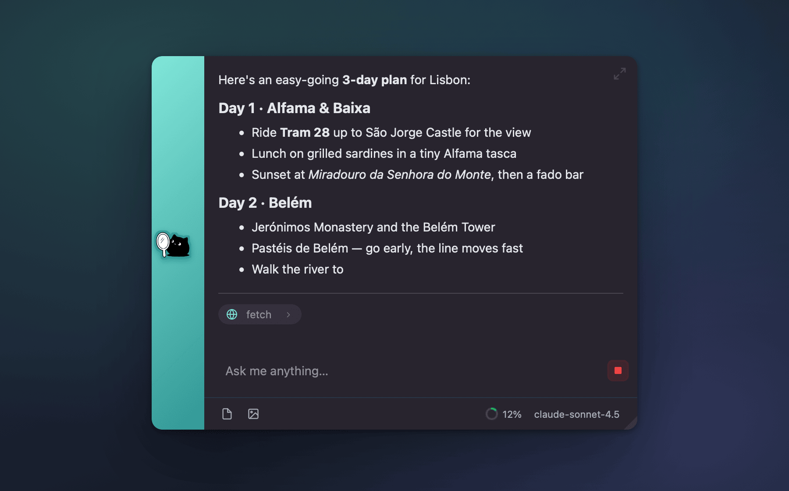
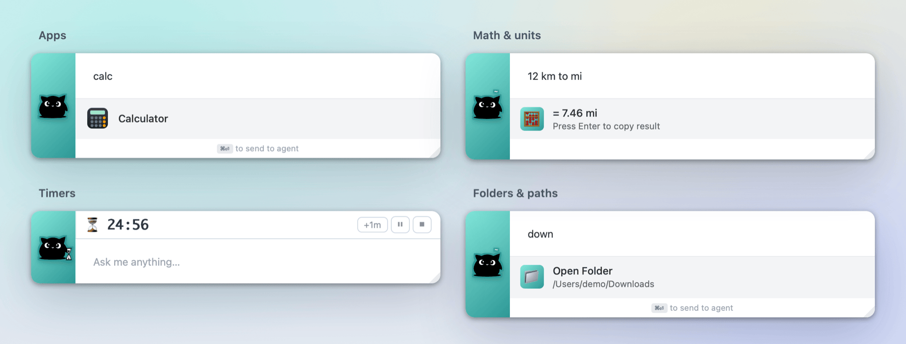
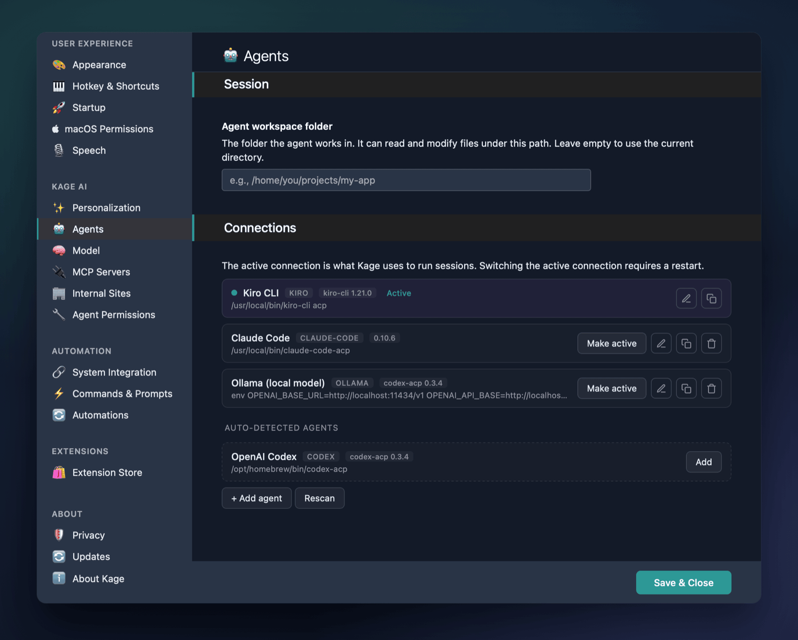
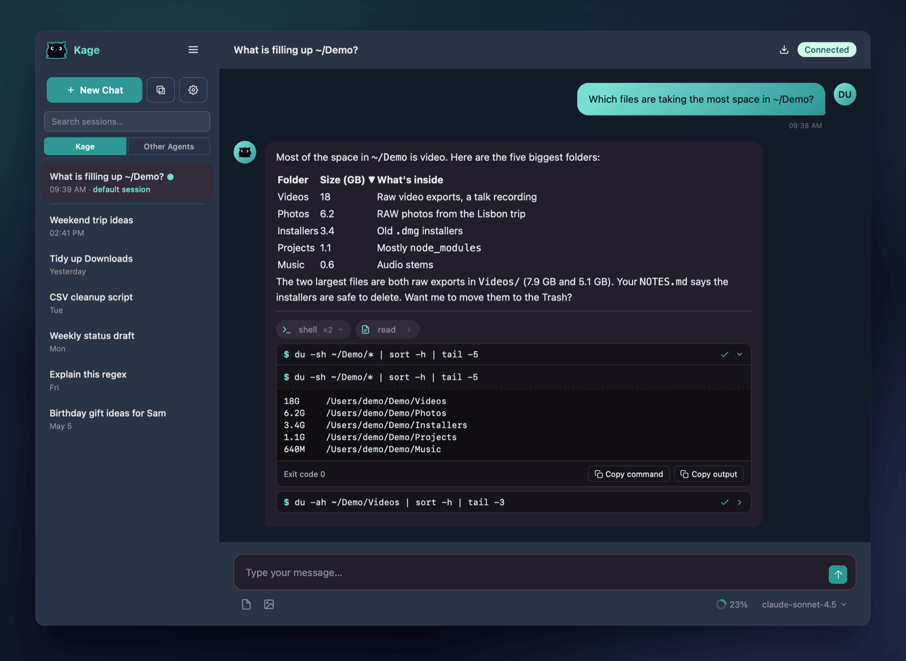
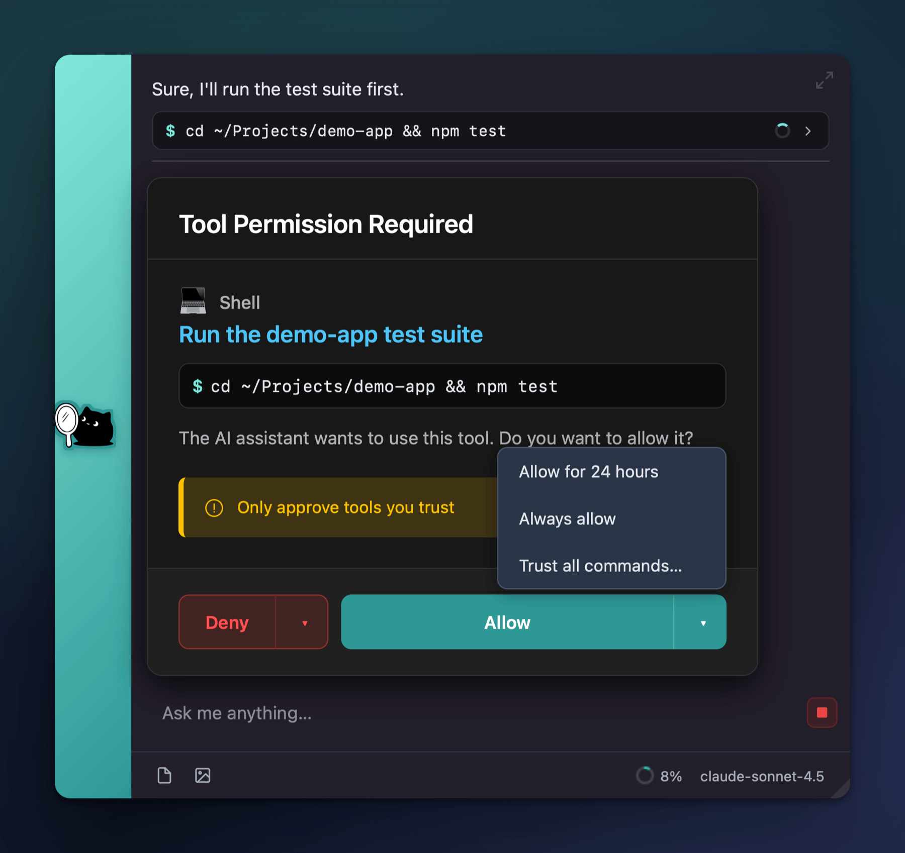
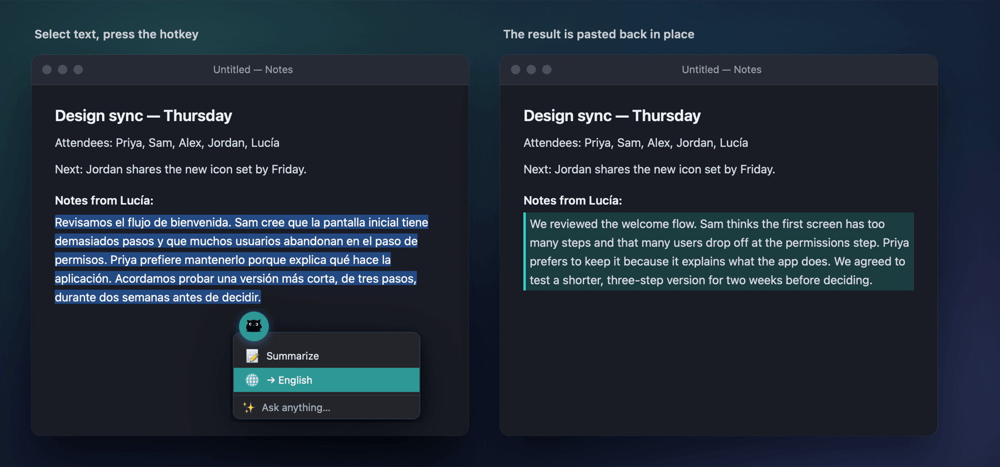
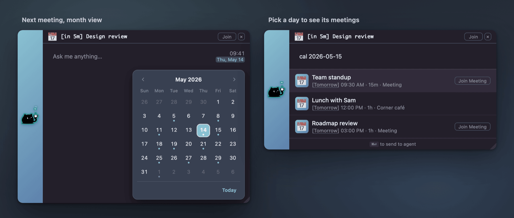
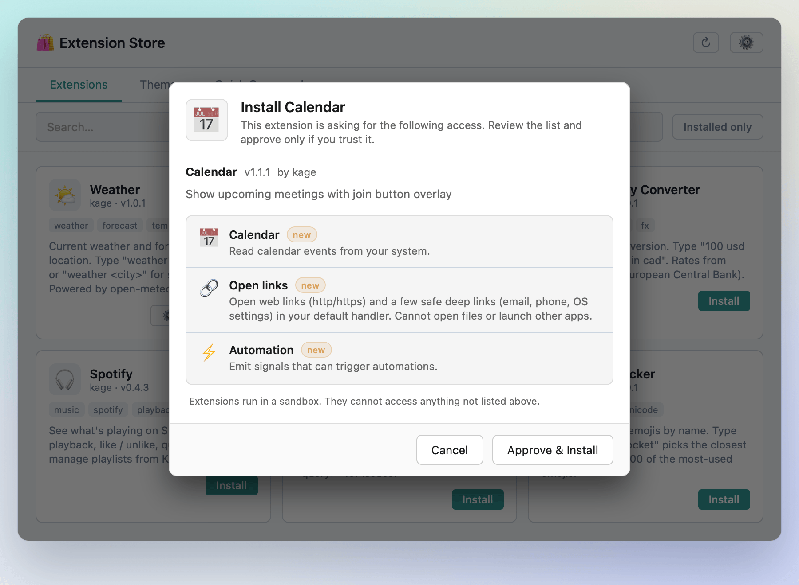

<p align="center">
  
</p>

<h1 align="center">Kage</h1>

<p align="center">
  <strong>Your AI, one keystroke away.</strong><br>
  A fast, extensible launcher for Windows and macOS that works with the AI agent you already use.
</p>

<p align="center">
  <a href="#install"></a>
  <a href="https://github.com/nachmore/Kage/releases/tag/dev-latest"></a>
  <a href="https://agentclientprotocol.com"></a>
  <a href="LICENSE"></a>
</p>

<p align="center">
  <a href="https://github.com/nachmore/Kage/releases/tag/dev-latest"><strong>Download</strong></a> ·
  <a href="#install">Install guide</a> ·
  <a href="#quick-start">Quick start</a> ·
  <a href="https://nachmore.github.io/Kage-Extensions/">Extension Store</a> ·
  <a href="docs/FEATURES.md">User guide</a>
</p>

<p align="center">
  <br>
  <sub>Asking for a Lisbon weekend plan from the launcher.</sub>
</p>

Press <kbd>Alt</kbd>+<kbd>Space</kbd> (<kbd>Option</kbd>+<kbd>Space</kbd> on a Mac) over any app and Kage opens a small bar where you are. Type a few letters to launch an app, convert units or open a folder. Or ask your AI agent a question and watch the answer stream in, along with every tool the agent uses to get there.

## Why Kage

- **Fast first.** Apps, math, timers and folders answer as you type, on your machine. None of it goes to the AI.
- **Your agent, not ours.** Kage doesn't include a model or need an account. It works with Kiro CLI, Claude Code, OpenAI Codex, a local model through Ollama, or any other agent that speaks the [Agent Client Protocol](https://agentclientprotocol.com) (ACP).
- **Nothing hidden.** Every file read, edit, search and shell command appears under the reply, with its output. The agent has to ask before it uses a tool you haven't allowed.
- **Yours to shape.** Sandboxed extensions, themes, your own commands and automations, 32 languages, and a cat that reacts to what's going on.

*Kage* (影) is Japanese for "shadow". It stays out of sight until you call it.

## Install

**You need:**

- **Windows** 10 or 11 (x64), or **macOS** 11 (Big Sur) or later on Apple Silicon. Intel Macs aren't supported, and there's no Linux build yet.
- **An agent.** Kage doesn't include a model, so install one of the [supported agents](#bring-your-own-agent) first.

Kage is under active development and publishes **Nightly** builds only for now. Download the newest from **[Releases → Kage Nightly](https://github.com/nachmore/Kage/releases/tag/dev-latest)**:

| Platform | File |
|---|---|
| Windows | `Kage_<version>_x64-setup.exe` |
| macOS (Apple Silicon) | `Kage_<version>_aarch64.dmg` |

### Windows

Run the installer. It installs for your user only, so you don't need admin rights, and it installs WebView2 if Windows 10 doesn't already have it. The builds aren't code-signed yet, so Microsoft Defender SmartScreen may say "Windows protected your PC". Choose **More info → Run anyway**.

### macOS

Kage's Mac downloads aren't signed or notarized yet, so macOS blocks them with a "damaged" or "can't be opened" message. **Before you open the DMG**, remove the quarantine flag in Terminal:

```bash
xattr -d com.apple.quarantine ~/Downloads/Kage_*_aarch64.dmg
```

Then open the DMG and drag Kage to Applications.

<details>
<summary><strong>Already installed and seeing "damaged"?</strong></summary>

```bash
# Remove the quarantined install
sudo rm -rf /Applications/Kage.app

# Remove the quarantine flag from the DMG
xattr -d com.apple.quarantine ~/Downloads/Kage_*_aarch64.dmg

# Re-open the DMG and drag Kage to Applications again
```

> **Why?** On macOS Sequoia (15) and later, the quarantine flag carries over into the installed app and can't be removed, even with `sudo xattr -cr`. The only reliable fix is to clear it on the DMG *before* you open it.

</details>

<details>
<summary><strong>macOS permissions</strong></summary>

Kage asks for each permission the first time it's needed. The setup wizard walks through them, and **Settings → macOS Permissions** shows whether each is granted.

- **Accessibility**: copying the selected text, pasting results back, raising a specific window, and computer control.
- **Screen Recording**: reading window titles. Kage doesn't capture what's on your screen.
- **Calendars**, **Microphone** and **Automation** (System Events) are requested only when you use a feature that needs them.

Global hotkeys don't need a permission, so Kage never asks for Input Monitoring.

After an update, System Settings can still show Kage as allowed while macOS ignores it. Click **Repair** on the card in Settings → macOS Permissions, then switch Kage back on.

</details>

### Updates

In Settings → Updates, **Automatically Check for Updates** checks once a day and **Silent Updates** installs quietly once the launcher has been idle for 5 minutes; without it you get an **Install now** banner. Unticking automatic updates during setup leaves both off, and `>version` checks by hand. Every download is verified against a signing key built into the app.

Channels: **Stable** and **Preview** (coming later) and **Nightly**. Only Nightly builds are published today, so stay on Nightly for now.

<details>
<summary><strong>Uninstalling</strong></summary>

- **Windows:** Settings → Apps → Installed apps (Apps & features on Windows 10) → Kage → Uninstall.
- **macOS:** quit Kage from the menu bar, then move `/Applications/Kage.app` to the Trash. If you used the ⌘Space option, Kage hands the shortcut back to Spotlight when it quits.

To remove your settings and extension data too, delete Kage's config folder (Settings → About Kage → Config folder opens it): `%APPDATA%\kage` (and `%LOCALAPPDATA%\kage` for logs) on Windows, `~/Library/Application Support/kage` on macOS.

</details>

## Quick start

1. **Install an agent** from the [table below](#bring-your-own-agent) and sign in to it the usual way.
2. **Open Kage.** The setup wizard finds your agents, then walks through your hotkey, launch at login, updates, computer control, learning your preferences, extensions and themes, analytics and, on a Mac, permissions. **Set it up for me** skips it: it picks the first agent it finds, installs the recommended extensions and uses the defaults.
3. **Press <kbd>Alt</kbd>+<kbd>Space</kbd>** (<kbd>Option</kbd>+<kbd>Space</kbd> on a Mac) and try:

| Type | What happens |
|---|---|
| `calc` | Launches the Calculator app |
| `12 km to mi` | `= 7.46 mi`; <kbd>Enter</kbd> copies it |
| `timer 25m` | Starts a countdown |
| `down` | Opens your Downloads folder |
| `w` and a space | Lists your open windows |
| `>` | Shows Kage's own commands |
| `Which files are biggest in my Downloads folder?` then <kbd>Ctrl</kbd>/<kbd>⌘</kbd>+<kbd>Enter</kbd> | Asks your agent. Kage asks before each new tool and shows every command it runs |

## Feature tour

The [user guide](docs/FEATURES.md) covers every feature in more detail.

### A launcher first, AI second

<p align="center">
  
</p>

- **Apps** by a few letters. Kage learns which result you pick and sees new installs right away.
- **Instant answers** for math and units, timers, UUIDs, hashes, base64, epoch times, JSON and colors, from extensions setup installs.
- **Folders, files and system commands.** `down` opens Downloads, `*.pdf` searches files, and `lock`, `sleep` or `terminal` do what they say. On Windows, `>cb` searches clipboard history.
- **<kbd>Enter</kbd>** on text that matches nothing sends it to your agent. <kbd>Ctrl</kbd>+<kbd>Enter</kbd> always does.

All the [keyboard shortcuts and `>` commands](docs/FEATURES.md#the-launcher) are in the user guide.

### Bring your own agent

<p align="center">
  
</p>

Kage is the front end; the thinking happens in an agent you run. Kage detects these:

| Agent | How Kage connects | Get it |
|---|---|---|
| **Kiro CLI** | `kiro-cli acp` | [kiro.dev](https://kiro.dev/) |
| **Claude Code** | The Claude Code ACP adapter, which Kage offers to install if it finds only `claude` | [claude-agent-acp](https://github.com/agentclientprotocol/claude-agent-acp) |
| **OpenAI Codex** | The `codex-acp` adapter, with `OPENAI_API_KEY` set | [codex-acp](https://github.com/zed-industries/codex-acp) |
| **Ollama** | A local model through `codex-acp`, so install both; then Settings → Agents → **+ Add agent** → Ollama | [ollama.com](https://ollama.com/download) + [codex-acp](https://github.com/zed-industries/codex-acp) |

You can add any other ACP agent by its command, or by host and port, and switch between saved connections. On macOS, Kage passes your shell's `PATH` to the agent, so it finds your tools even when Kage was opened from the Dock.

### Chat, with every step in view

<p align="center">
  
</p>

- **Tool chips** under each reply group what the agent read, edited, searched, fetched or ran. Expand one for diffs, arguments, results and errors.
- **Shell commands** show the exact command, live status, exit code, stdout and stderr, with copy buttons.
- **Rich replies:** highlighted code, math, Mermaid and Graphviz diagrams, sortable tables, and HTML previews in a sandbox.
- **Sessions** to search, rename and export, a context-usage ring, a model picker, attachments, and plans you review before multi-step jobs run.

### You decide what the agent runs

<p align="center">
  
</p>

- **Allow** once, for 24 hours or always, or **Deny** once or always. An unused "always" expires after 30 days.
- **Trust all commands**, or all tools from one MCP server, after a confirmation. **Always deny** still wins, and background features always ask.
- **Settings → Agent Permissions** lists every tool and trusted server, with a local audit log and a reset button.
- **Terminator Mode** approves everything you haven't set to Always deny, until you switch it off. A banner reminds you while it's on.

More detail: [Tool Permissions](docs/TOOL_PERMISSIONS.md).

### Inline assist: AI inside any app

<p align="center">
  
</p>

- Select text in any app and press <kbd>Ctrl</kbd>+<kbd>Shift</kbd>+<kbd>Space</kbd>. Actions that suit the text appear at the cursor, or type your own in the **Ask anything** box.
- Edits such as **Translate** or **Format** are pasted back in place; answers such as **Summarize** or **Explain** open in the chat window.
- The main launcher picks up your selection too: tick **Include selected text**, or use the quick-action chips.

### Your day at a glance

<p align="center">
  
</p>

- Turn on the clock and date in Settings → Appearance; click the date, or press <kbd>Alt</kbd>+<kbd>↓</kbd>, for a keyboard-friendly month calendar.
- With the **Calendar** extension (installed by setup): a next-meeting bar with **Join**, busy-day dots, `cal` and `meetings`, and appointment lookups for your agent.
- Meetings come from the Calendar app on macOS and from classic Outlook for desktop on Windows.

### Commands, automations, computer control and voice

- **Commands & Prompts:** trigger words that open a program or URL (make `yt cats` search YouTube), send a prompt with `{selection}`, or run a script. See the [Shortcuts Guide](docs/SHORTCUTS_GUIDE.md).
- **Automations:** chains of AI prompts, find & replace, text transforms, conditions and scripts. Run them by hand, on a schedule, or when a meeting is about to start or a todo falls due.
- **Computer control:** an optional MCP server that lets your agent launch apps, read and click their interface, type and tidy folders. Setup registers it with Kiro CLI; [other agents](docs/FEATURES.md#computer-control) need `kage-computer-control-mcp` added to their MCP settings.
- **Voice:** turn on the microphone button in Settings → Speech, and have replies read aloud with system voices or the local **Pocket TTS** engine.

Details for all four are in the [user guide](docs/FEATURES.md#commands-prompts-and-automations).

### Make it yours

<p align="center">
  
</p>

- **Themes:** Kage Light, Kage Dark, or Auto, which follows your OS, plus Nord, Sunset and Kiro‑ish from setup. Changes apply everywhere without a restart.
- **32 languages,** with a full right-to-left layout for Arabic, Hebrew, Persian and Urdu. English is written by hand and the rest are machine-translated ([full list](docs/FEATURES.md#languages)).
- **Hotkeys and the launcher:** where it opens, opacity, font size and more. On a Mac, ⌘Space can replace Spotlight while Kage runs.
- **The cat** breathes, blinks and reacts as you type and wait. It wears a party hat after an update and, with extensions, a headset in meetings; it even bops along to music. **Animate Kage** in Settings → Appearance turns it off.
- **Backup and restore** settings, prompts and extension data as a `.kage` file.

## Extensions and the store

<p align="center">
  
</p>

Extensions add most of what Kage does. Browse the **Extension Store** in Kage (`>store`) or [on the web store](https://nachmore.github.io/Kage-Extensions/), where `kage://install/…` links open Kage and offer the install.

**Every extension is treated as untrusted**, including the ones setup installs. Each runs in a sandbox, and Kage checks every request it makes (clipboard, files, windows, calendar, the agent…) against the access it declared. You see that list before you install, and again if an update asks for more.

**Setup installs** the ten extensions below and the three extra themes, all ticked by default.

<details>
<summary><strong>Extensions setup installs</strong></summary>

| Extension | Try typing | What it does |
|---|---|---|
| Math Calculator | `12 km to mi` | Math and unit conversions; <kbd>Enter</kbd> copies the answer |
| Timer & Stopwatch | `timer 5m` | A countdown bar with +1 min, pause and stop, and a sound at the end |
| Calendar | `cal` | Next-meeting bar, busy-day dots, meetings for any day, appointment tools for the agent |
| Window Walker | `w` and a space | List and switch between open windows, minimized ones included |
| Todos & Reminders | `todo` | Tasks with due dates, categories, priorities and a due-date banner |
| Developer Tools | `uuid` | UUIDs, base64, hashes, epoch conversion, JSON formatting |
| Dictionary | `dict serendipity` | Definitions, spelling suggestions and pronunciation. **Online:** freedictionaryapi.com and api.datamuse.com |
| Color Picker | `#38b2ac` | Color preview and conversion between hex, rgb, hsl and names |
| Link Preview | (automatic) | Preview cards for links in replies. **Online:** fetches each linked page |
| Focus Tracker | `focus` | App use, context switches and focus streaks, with reports and AI insights |

</details>

<details>
<summary><strong>More in the store</strong></summary>

| Extension | Try typing | What it does |
|---|---|---|
| Currency Converter | `100 usd to eur` | European Central Bank rates. **Online:** frankfurter.dev |
| Weather | `weather lisbon` | Current conditions and forecast. **Online:** OpenStreetMap Nominatim (the place you type) and open-meteo.com |
| Emoji Picker | `:fire` | Search about 1,500 emojis and copy one |
| Password Generator | `pw` | Strong random passwords and passphrases |
| Snippets | `snip` | Saved text you can copy from the launcher |
| Bookmarks | `bm docs` | Save and open your bookmarks |
| GitHub Search | `gh tauri` | Search repositories, users and issues. **Online:** api.github.com |
| Spotify | `sp` | Now playing, playback, likes, queue and playlists, plus agent tools. You register your own free Spotify app. **Online:** Spotify |

</details>

Want to build one? Start with the [Extension Development Guide](docs/EXTENSIONS.md) and the `hello-world` sample in [Kage-Extensions](https://github.com/nachmore/Kage-Extensions).

## Privacy and security

- **No Kage account and no Kage cloud.** Your prompts go to the agent you connect, and from there to whichever model service that agent uses (or nowhere else, with a local Ollama model).
- **Prompts say where you came from.** By default, each prompt from the launcher or inline assist includes the name and window title of the app you were in. Titles can contain document names, email subjects or file paths. Turn it off in Settings → System Integration → **Screen context awareness**.
- **What else goes online:**
  - Empty connectivity checks to `www.msftconnecttest.com`, `www.cloudflare.com` and `www.google.com` at startup, when you open Kage, and while it thinks you're offline.
  - GitHub, for update checks, downloads and the changelog, and GitHub Pages (`nachmore.github.io`) for the Extension Store.
  - Extensions marked **Online** in the [tables above](#extensions-and-the-store). Of the ones setup installs, Dictionary sends the words you look up, and Link Preview fetches pages linked in replies.
- **Analytics are optional.** Setup explains them on their own page, with a **Send anonymous usage data** switch that starts out on (**Set it up for me** keeps it), and nothing is sent before setup finishes. Events go to [Aptabase](https://aptabase.com) in the EU and never include your messages, prompts, replies, file names or paths, clipboard, name or email; a crash sends only a category and a code location. Turn analytics off or reset your random install ID in **Settings → Privacy**; to have your data deleted, open a GitHub issue with that ID. Full policy: [PRIVACY.md](docs/PRIVACY.md).
- **You stay in control.** You approve the agent's tools, extensions are [sandboxed](docs/SECURITY_MODEL.md), updates are signed, and the preferences Kage learns sit in a file you can view, edit or turn off in Settings → Personalization.

## Documentation

- [User guide](docs/FEATURES.md): every feature, shortcut and `>` command
- [Shortcuts Guide](docs/SHORTCUTS_GUIDE.md): your own commands and prompts
- [Tool Permissions](docs/TOOL_PERMISSIONS.md): how Kage decides what the agent may run
- [Security Model](docs/SECURITY_MODEL.md): how extensions are sandboxed
- [Privacy Policy](docs/PRIVACY.md)
- [Agent tools and your shell environment (macOS)](docs/AGENT_ENVIRONMENT.md)
- [Internal Sites](docs/INTERNAL_SITES.md): link previews for pages behind your sign-in
- [Building Kage](docs/BUILDING.md) and the [Extension Development Guide](docs/EXTENSIONS.md)

## Build from source and contribute

Kage is built with [Tauri 2](https://tauri.app): a Rust backend and a plain HTML, CSS and JavaScript front end. With Rust, Node.js and Python 3 (as `python`) installed:

```bash
cargo install tauri-cli --version "^2" --locked
cd ui-vendor && npm install && cd ..
cargo tauri dev
```

Prerequisites, release builds, signing and analytics keys, the test suite and how Kage works inside are in **[docs/BUILDING.md](docs/BUILDING.md)**.

Found a bug or have an idea? [Open an issue](https://github.com/nachmore/Kage/issues/new/choose). There are templates for bug reports, feature requests and general feedback.

## License

Kage is released under the [Apache License 2.0](LICENSE).
